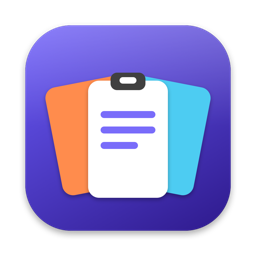
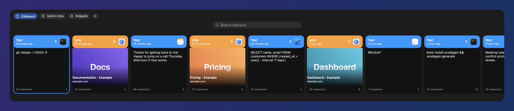
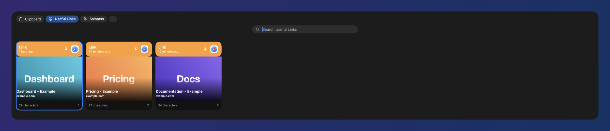

<p align="center">
  
</p>

<h1 align="center">ppaste</h1>

<p align="center">
  <b>A fast, local-only clipboard history for macOS.</b><br>
  Press a hotkey, search, pick, and it's pasted into the app you were using.
</p>

<p align="center">
  
  
  
  
</p>

---

Built as a free, open-source alternative to paid clipboard managers. No account, no cloud, no tracking: your history never leaves your Mac. (The one network feature, link previews, is optional - see [Privacy](#-privacy).)

> **Cmd+Shift+V** &rarr; a shelf of your recent copies slides up along the bottom of the screen.

<p align="center">
  
</p>

<p align="center"><i>Pin the things you reach for most into pinboards:</i></p>

<p align="center">
  
</p>

<sub>Screenshots use made-up demo data.</sub>

## ✨ Features

- **Bottom shelf** of cards: text, links and images, each with the source app's icon, a relative timestamp and a character count
- **Pinboards** - named collections of saved clips, shown as tabs along the top of the shelf. Pinned clips are never pruned (including images). Create one with "+", rename/delete from a tab's right-click menu
- **Instant search** - just start typing when the shelf is open
- **Paste straight into the previous app** with Enter, or quick-paste the first nine items with Cmd+1-9
- **Long history** - text and links are kept forever; images are pruned after 30 days by default (configurable) unless they are pinned to a pinboard
- **Duplicates are merged** - copying something again moves it to the front instead of cluttering the list
- **Rich link previews** - copied web links show the page title and preview image (falls back to the site icon), fetched in the background; can be switched off from the menu bar (see Privacy)
- **Privacy-aware** - ignores concealed/transient pasteboard items and password managers (1Password, Bitwarden, KeePassXC, Keychain, Passwords)
- **Settings** (menu bar → Settings…, ⌘,) - record your own shortcuts, choose how long images are kept, ignore specific apps, toggle link previews
- **Launch at login** - toggle it in Settings or the menu-bar menu (works once ppaste is installed in `/Applications`, which `scripts/install.sh` does for you)
- **Menu-bar only** - no Dock icon, native Swift/SwiftUI, tiny footprint
- **Local storage** in a SQLite database at `~/Library/Application Support/ppaste/`

## ⌨️ Keyboard shortcuts

| Key | Action |
| --- | --- |
| Cmd+Shift+V or Ctrl+Shift+V | Open / close the shelf |
| Type, or Cmd+F | Search (Cmd+F refocuses the search field) |
| Left / Right | Move between cards |
| Enter | Paste the selected card into the previous app |
| Cmd+1 ... Cmd+9 | Paste the 1st-9th card |
| Cmd+Delete | Delete the selected card (on a pinboard tab: remove it from that pinboard) |
| Tab / Shift+Tab, or Cmd+] / Cmd+[ | Next / previous tab (Clipboard, then each pinboard) |
| Cmd+P | Pin the selected card to a pinboard (picker: arrows or 1-9, Enter) |
| Right-click a card | "Pin to...", "Remove from pinboard" |
| Esc | Clear the search, then close the shelf |

Binding Cmd+Shift+V overrides "Paste and Match Style" in other apps while ppaste is running.

## 📦 Install

Requires macOS 14 (Sonoma) or later and Xcode.

```sh
brew install xcodegen
git clone https://github.com/pcollins-tech/ppaste.git
cd ppaste
./scripts/install.sh
```

This builds a Release version, copies it to `/Applications/PPaste.app` and launches it. Run it again to update.

### Permissions

The first time you paste, macOS asks for **Accessibility** access. ppaste needs it to send Cmd+V to the app you were using. Without it, the item is still copied to your clipboard and you can paste it yourself.

The app is signed ad-hoc, so macOS may ask you to grant Accessibility again after a rebuild. To avoid that, sign with a stable identity: `CODESIGN_IDENTITY="Your Certificate Name" ./scripts/install.sh`.

## 🛠 Development

```sh
swift test          # unit tests for the core library
xcodegen generate   # regenerate PPaste.xcodeproj from project.yml
```

| Path | Purpose |
| --- | --- |
| `Sources/PPasteCore` | Clip model and SQLite store (GRDB): dedupe, search, retention |
| `Tests/PPasteCoreTests` | Unit tests for the core |
| `App/` | Menu bar, global hotkey, pasteboard watcher, shelf UI |
| `project.yml` | XcodeGen project definition |

Dev switches (environment variables): `PPASTE_DATA_DIR=/some/folder` runs against a separate data folder with the clipboard watcher off, and `PPASTE_SNAPSHOT_FILE=out.png [PPASTE_SNAPSHOT_PINBOARD=0]` renders the shelf to a PNG and quits. That is how the screenshots above were made, from a demo database.

## 🗺 Roadmap

- Rich text and file clips, with true "paste as plain text"
- Full-text search

## 🔒 Privacy

ppaste stores everything on your machine. Anything you copy is saved, so treat the history folder like your clipboard: it can contain sensitive data. Use the menu-bar item "Clear All History..." to wipe it.

**Link previews make network requests.** When you copy a web link, ppaste (by default) contacts that link's host to read the page title and a preview image, so the site can see a request from your IP address. This is the only network access ppaste has; nothing else is sent anywhere, and nothing is sent to any server run by ppaste.

- Turn it off with the menu-bar item **Fetch Link Previews** (checkmark = on). The setting is remembered. With it off, ppaste makes no network requests at all and link cards show the plain URL.
- Only `http` and `https` links are fetched, once per copied link, with an 8 second timeout. Responses are capped (about 1 MB of HTML, 2 MB per image). Requests use a private session with no cookies, credentials or cache and a generic User-Agent.
- **Skipped entirely:** `localhost`, `.local`/`.internal`/`.lan` and other single-label or intranet host names, private and link-local IP addresses (10.x, 172.16-31.x, 192.168.x, 127.x, 169.254.x, IPv6 addresses), links containing a username or password, and links whose query string or fragment has parameters that look like secrets (names containing token, key, secret, password, auth, signature, session, code and similar). Redirects to such addresses are refused too.
- Not covered: a link can still be private without looking it. A hostname that publicly resolves to an internal address is not detected, and secrets embedded in a URL path are not detected. If that matters to you, turn previews off.
- Preview images are stored in `~/Library/Application Support/ppaste/link-previews/` and deleted after 30 days, like image clips. The link and its title are kept.

## 🤝 Contributing

Issues and pull requests are welcome. Please run `swift test` before opening a PR.

## 📄 Licence

[MIT](LICENSE)

ppaste is an independent project and is not affiliated with or endorsed by the makers of Paste.
